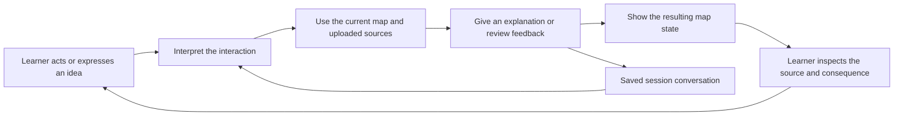
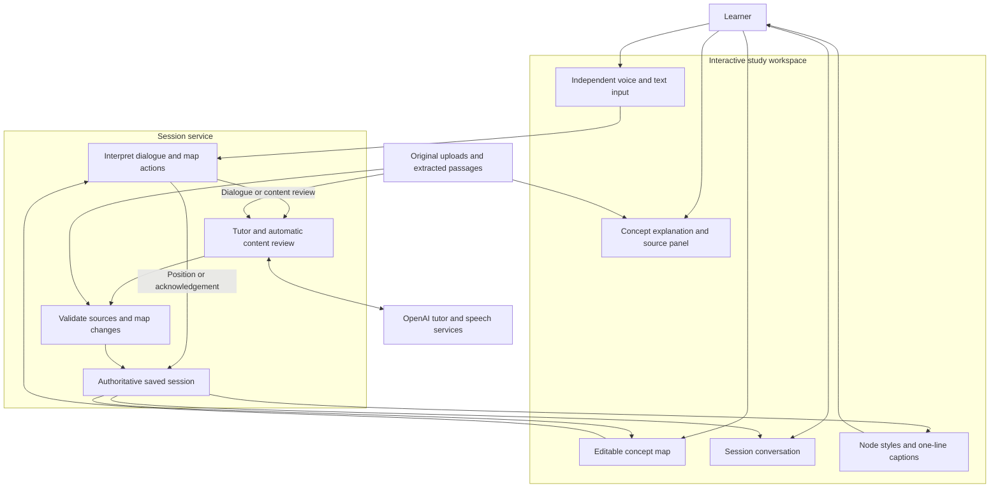
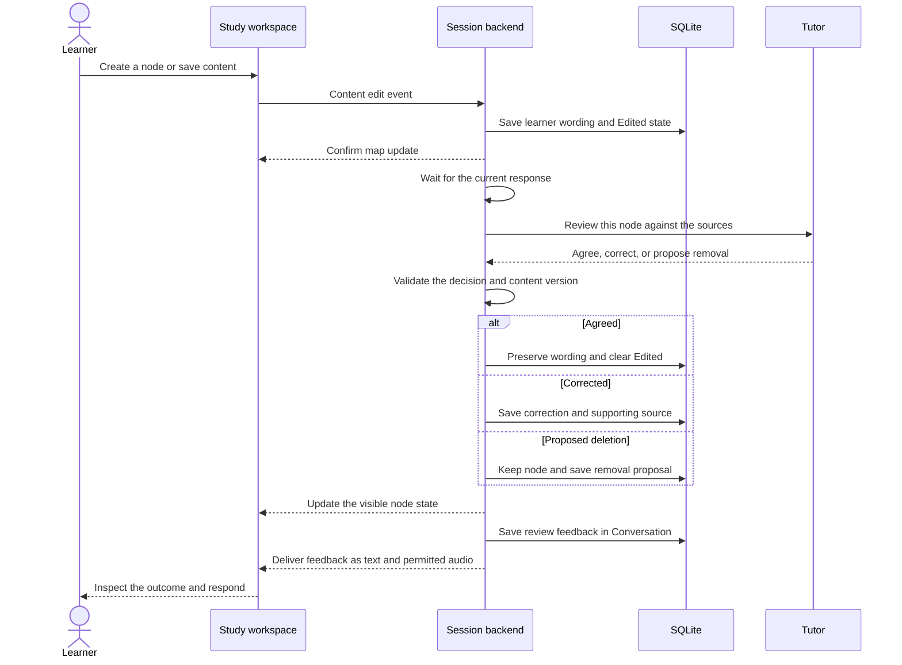
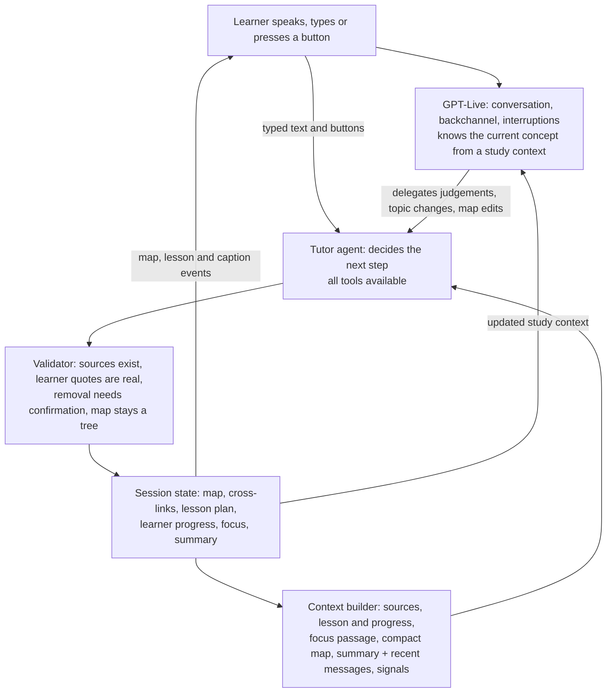

# Dyscover interactive design architecture

**Architecture snapshot: 24 October 2026**

## 1. Interaction as the organizing idea

**Interaction is the core of Dyscover.** The learner's questions, explanations, source inspection, and edits continuously influence a shared concept map. The tutor responds to those actions, and the learner can inspect, revise, or challenge the response. The map is a visible record of that developing exchange.

The central design unit is an interaction with observable consequences: what the learner does, how the system interprets it, what changes, and how the learner responds next. Uploading material starts the process; the subsequent learning experience is a repeating cycle rather than a one-way document-to-map conversion.

The design supports university learners who want to work through course material in manageable pieces, including learners with dyslexia. It aims to reduce the need to hold a long explanation in memory while searching a document. These are design intentions; educational benefit and accessibility effectiveness require user evaluation.

Source inspection and visual arrangement are local interactions: they do not need an AI response. Their value is that they let the learner understand and control the shared representation.

## 2. Principles that shape the architecture

### Learner actions must have distinguishable consequences

Opening a concept, moving a box, changing an explanation, and speaking an assertion mean different things. The architecture keeps those actions separate. A node click opens information without speech. Dragging changes coordinates without implying a change of understanding. Saving content requests an automatic review.

### The map is shared and revisable

Both learner and tutor can contribute ideas. The tutor can propose additions and identify misconceptions; the learner can create concepts, rewrite descriptions, request a different hierarchy, or retain an idea the tutor suggests removing. Authorship and review state remain visible through labels and styles.

### Evidence stays within reach

An explanation or review is connected to a passage in the learner's material when available. The learner can inspect the quotation and open the original file. A source link makes a judgment inspectable; it does not independently establish that the AI interpreted the source correctly.

### Feedback should help the learner continue

A lesson plan gives every session a direction. The tutor explains the current concept, invites the learner to say it in their own words, records how well they understood it, and moves on. Explained concepts appear on the map straight away as introduced; they turn understood, with the learner's own words, only when the learner explains them. After a second unsuccessful attempt, or when the learner says they don't know or want to skip, the tutor gives the answer, marks the concept for review and continues. It never ends two replies in a row with a question and never repeats a question.

### Consequential changes need appropriate control

Ordinary supported additions and corrections currently apply to the map without a universal approval dialog. Deletion is different: a system proposal is crossed out and retained until the learner confirms it. This distinction matches the implemented prototype. A preview-and-accept flow for every addition remains a possible future design, not a current feature.

### The learner must be able to return to the exchange

One-line rolling captions support the immediate interaction and remain available until replaced by subsequent speech. The full session transcript preserves the dialogue for later reading. Reopening a saved session restores the map, materials, and messages so the learner can continue the same study context.

## 3. The interaction contract

| Learner action | System interpretation | Immediate response | AI involvement |
|---|---|---|---|
| Open a node | Inspect an existing concept. | Show its explanation and source; clear New if present. | None. |
| Open an original file | Check evidence. | Open the stored material in the browser or download it. | None. |
| Drag or keyboard-move a node | Rearrange the view. | Save its position and redraw connectors. | None; coordinates are excluded from tutor input. |
| Arrange branches | Explicitly tidy the automatic layout. | Regroup automatic branches while retaining manual positions. | None. |
| Speak or type an explanation | Offer an understanding to discuss. | Record the statement, then generate grounded feedback. | Tutor, plus transcription/speech services when applicable. |
| Ask for an explanation | Request assistance. | Explain from the supplied material, map the concept as introduced, and invite an explanation back. | Tutor. |
| Press a lesson step | Choose what to study. | Make that concept the focus and teach it. | Tutor. |
| Ask for missing content | Request guided exploration. | Identify and explain uncovered components within the existing map. | Tutor. |
| Create a connected idea | Add learner-authored content. | Save an Edited node and queue its review. | Automatic review. |
| Save a label or description | Revise content. | Save the new wording, mark Edited, and queue review. | Automatic review. |
| Keep a proposed removal | Reject that deletion proposal. | Clear the proposal and retain the node and its content state. | None for the Keep action itself. |
| Confirm deletion | Authorize removal. | Remove the node and its connected descendant branches. | None. |
| Open Conversation | Review the dialogue across topics. | Show stored and live messages in one session transcript. | None. |

These actions are available throughout the study thread. The learner does not have to select a separate Explain or Explore mode before speaking or typing.

## 4. Conceptual architecture

The workspace makes the interaction visible. The service interprets intent and maintains the saved session. The evidence layer supplies the material the tutor is allowed to use. The model generates candidate responses; the validator decides whether their structure and references can be applied.

The implementation uses one tutor model for dialogue and reviews. It does not require a separate autonomous agent for each visual component. Separation is achieved through action types, validation rules, and clear responsibilities.

## 5. Architecture of the interaction loops

### 5.1 Explanation and exploration

A typed question or transcribed utterance enters the same tutor path. The current map, saved descriptions, source passages, and recent session conversation establish context. After initial root creation, a bounded backend tutor agent searches uploaded passages and proposes individual operations with strict tool schemas. It stages changes against a snapshot; the backend validates and saves the resulting map before emitting changes. Deletion, renaming, and movement have separate permissions and exact targets. Ambiguous names require clarification; selecting a node provides silent context.

The backend checks the plan before emitting map events. During ordinary turns it preserves existing parents, labels, ordering, descriptions, and manual positions, while allowing supported additions and corrections. Explicit parent changes use the move tool; explicit renaming uses the separate rename tool.

The answer becomes a complete saved message. Audio and temporary captions present that answer during the interaction; the transcript remains available as the conversation continues.

### 5.2 Learner edits and automatic review

Saving content is a learning interaction in its own right. A learner can express an idea by writing a node rather than by composing a chat message. The system therefore reviews a created or edited node automatically, without requiring a second request.

Automatic reviews are serialized after any active response on the connection. They evaluate the requested node without adding unrelated concepts. If the learner changes that node while the model is working, the backend retries against the current saved wording. A superseded response must not approve an older version of the note.

Agreement changes review state, not authorship of the wording: the learner's saved label and description are retained. A correction must quote an actual learner statement or learner-authored content. The system cannot turn one of its own invented concepts into a supposed learner misconception.

A failed review leaves the edit saved and marked for attention. Pausing voice does not prevent a review from completing; its feedback is then delivered as text and retained in Conversation. Reviews use AI request allowance, including validation retries.

### 5.3 Evidence inspection

Opening a node follows a read path. It reveals the explanation and citation and acknowledges New, but does not ask the tutor to speak. The learner can compare an explanation with the original source at their own pace.

For image material, the panel can display the original image. For text material, it presents a short extracted quotation and reference. A learner-authored idea without a verified citation is identified as such rather than being given a fabricated source.

### 5.4 Visual arrangement

Position is separate from meaning. Dragging or keyboard movement updates a coordinate field; it does not change the label, summary, parent relationship, or semantic review state. The tutor does not receive coordinate values as evidence about the learner's understanding.

Ordinary expansion avoids rearranging existing positions. The explicit Arrange branches control requests a fresh automatic arrangement. Distinct curved connectors and space between branches help the learner trace relationships without confusing unrelated edges for a shared trunk.

### 5.5 Proposing and deciding on deletion

A removal proposal is an invitation to make a decision, not a completed mutation. The backend retains the node and its content, records the reason, and displays crosslines. A conflicting correction flag must not replace the removal proposal.

The learner can open the node, inspect the reason and source, then Keep it or Confirm deletion. Confirmation removes the node and its descendants; the interface states that consequence before applying it. There is no implemented undo for a confirmed deletion.

## 6. Representing state without confusing the learner

Node appearance expresses what needs the learner's attention. Structural role, authorship, review outcome, and proposed removal are distinct pieces of state, even though the interface presents a clear visual priority.

| Visible state | Meaning | Transition |
|---|---|---|
| New in blue | A system-created concept has not been inspected. | Opening it clears New and preserves the content. |
| Edited in red | Learner-created or changed content awaits agreement. | Automatic review clears the marker, corrects the content, or proposes removal. |
| Corrected in orange | A learner claim or note has received a supported correction. | The learner can inspect the source and save a further revision. |
| Crossed out with a dashed frame | Removal has been proposed but not authorized. | Keep clears the proposal; confirmation deletes the node and descendants. |
| Default frame | No outstanding new/edit/correction marker applies. | Later dialogue or edits can introduce a new state. |

Removal has visual priority while a decision is pending. Keep restores the node's retained content state; it does not automatically certify an unverified learner note. The dark root appearance communicates its structural role and is separate from the review markers.

## 7. Feedback over different timescales

**Immediate feedback** acknowledges clicks, saves, movement, and connection state. Local changes can appear optimistically; the backend confirms them or returns an error and authoritative map state.

**Processing feedback** shows Thinking while a response or review is pending. The learner should be able to distinguish an operation in progress from a completed judgment.

**Conversational feedback** explains the result using brief speech and text. Captions roll within one line and remain until replaced by subsequent speech. Typing remains available with microphone capture off.

**Persistent feedback** retains the complete dialogue, explanations, citations, map state, and review results. Session-wide conversation avoids fragmenting a discussion that moves across several concepts. Stable message IDs prevent streamed caption fragments from becoming duplicate history entries.

The full spoken conversation is not stored as a recording. The live implementation retains transcripts; explicit reply replay uses browser speech when no stored audio URL is available.

## 8. Implementation responsibilities

| Responsibility | Implementation | Interaction guarantee |
|---|---|---|
| Capture intent | Voice dock, text input, silence-based audio segmenter | Spoken and typed requests reach the same tutor path. |
| Distinguish actions | Typed client events and backend event dispatch | Inspection and movement do not start content review. |
| Show a shared model | ConceptMap, layout module, React state store | The learner can inspect and edit the visible representation. |
| Keep evidence accessible | Original uploads, extracted passages, NodePanel | Explanations can be checked against retained material. |
| Interpret and review | Structured tutor requests and review scheduling | Content edits trigger a focused review with explicit feedback. |
| Validate consequences | tutor.py and checked_plan | Source identifiers, map structure, review outcomes, and correction provenance are checked. |
| Preserve continuity | SQLite and session-wide message IDs | Reopening restores saved progress independently of the rolling caption display. |
| Protect access | Signed ownership cookie and origin checks | Sessions and original files are checked against browser ownership. |

The frontend uses React, TypeScript, and a REST/WebSocket client. FastAPI handles sessions, extraction, live interactions, and storage. The voice pipeline is transcription followed by tutor generation and speech generation. It is not a direct speech-to-speech implementation.

The tutor currently reads extracted passages directly; an embedding-based retrieval layer is not implemented. Model details, launch commands, limits, and user instructions are maintained in [the prototype overview](PROTOTYPE_OVERVIEW.md). Event contracts are maintained in [the API document](../Dyscover/docs/API.md).

## 9. State and data ownership

A session contains its summary, uploaded material references, original file data, source passages, concept map, concept details, global messages, and usage-related progress. Position belongs to map presentation. Label and description belong to semantic content. A review decision refers to the version of that content the tutor evaluated.

The backend is authoritative for persistence. The model can propose a plan, but cannot directly delete database rows or bypass validation. The interface can display a tentative local action, but server rejection must remain visible rather than appearing as successful persistence.

Shared demonstration credentials do not implement a complete multi-user account system. The signed cookie identifies a browser's ownership of study sessions. SQLite durability also depends on the hosting filesystem; a live interactive demonstration needs a clear storage and recovery plan.

## 10. What is implemented and what remains a design direction

| Area | Working prototype | Further design work |
|---|---|---|
| Interaction choice | Direct speaking, typing, inspection, creation, and editing throughout a thread | User evaluation of discoverability and cognitive effort |
| Shared map | Editable tree with retained positions and explicit arrangement | Richer connection editing and evaluation of alternative visual structures |
| Edit feedback | Automatic focused review and three visible outcomes | Better handling of ambiguous evidence and richer learner disagreement |
| Learner control | Keep or confirm proposed deletion; edit any node's content | Undo and a possible preview flow for other consequential changes |
| Conversation | Persistent session transcript separate from rolling captions | Search, export, and optional study summaries |
| Sources | Passage references and access to original uploads | Stronger diagram understanding and more precise page highlighting |
| Continuity | Saved sessions and a per-connection review queue | Durable review jobs that resume automatically after disconnects |
| Accessibility | Readability choices, keyboard movement, captions, and independent text input | Testing with learners and assistive technologies |

The current review queue lives with the active connection. An interrupted review can leave a saved Edited node; reopening does not provide a durable background-job recovery mechanism. The learner can save the content again to request review. This is a limitation to address before claiming reliable offline or cross-device continuity.

## 11. Example of the intended interactive experience

Consider a learner studying a Java handout. They ask, “What parts have we not covered?” Dyscover uses the handout and current map to explain additional components. Dyscover maps the explained concepts as introduced; each turns green with the learner's own words once they explain it. The learner opens Records, reads the source passage, and checks the original file without triggering speech.

They move the Records box so the diagram is easier to read. Its meaning and review marker remain unchanged. They then rewrite its description in their own words. That semantic edit is saved, marked Edited, and reviewed automatically. A supported note receives Agreed feedback and returns to the default style while preserving the learner's wording.

If the learner introduces a misconception, the tutor gives a sourced correction quoting the actual note. If the system has introduced an unsupported “final class” topic, the appropriate outcome is a removal proposal rather than a fabricated learner misconception. The node remains visible until the learner chooses whether to keep it or confirm deletion.

The learner can revisit the whole exchange in Conversation beyond the one-line caption display. Each step connects an action, an explanation, evidence, a visible state change, and another learner decision.

## 12. Evaluating whether the interaction works

The evaluation should test the learner's ability to understand and influence the system, alongside technical correctness.

- Can the learner explain why a node appeared and find its source?
- Can they tell the difference between a new concept, their own edit, a correction, and a deletion proposal?
- Can they ask for guidance without entering a repeated-question loop?
- Does moving a node leave its semantic state unchanged?
- Does saving content receive understandable feedback without another chat prompt?
- Does a review evaluate the latest saved note rather than an older version?
- Can the learner refuse a deletion and continue working?
- Can they return to the full dialogue after captions change or a session reopens?

Technical checks support these questions: action routing, stable message IDs, source validation, stale-review handling, and confirmation-based deletion are covered by automated tests. Selected model and browser checks demonstrate important paths. Formal learning outcomes, timing targets, and accessibility effectiveness have not yet been established.

## 13. Architecture decision summary

The system is organized around a learner-controlled feedback loop. The editable map externalizes the learner's developing understanding, the tutor contributes grounded explanations and reviews, and the evidence panel makes those contributions inspectable. Temporary speech feedback and persistent conversation serve different needs within the same interaction.

Future features should strengthen this loop. A proposed feature should make it easier to express an idea, understand a response, inspect evidence, revise the shared map, or make an informed decision. New processing stages should preserve those interaction guarantees rather than obscuring the learner's influence on the session.

## 14. GPT-Live interaction transport

Live mode preserves the same learner → explanation → evidence → map feedback loop while separating conversation timing from grounded backend work. Browser PCM travels through the authenticated FastAPI WebSocket to GPT-Live; the project API key remains server-side. Live handles speech and transcripts. The existing backend agent handles delegated requests, evidence lookup, edit review and validated map operations.

Delegation carries metadata, not an utterance. The server assembles requests from timestamped transcript fragments and saved state, associates verified results with the original delegation ID, and discards map results superseded by newer learner input. Node inspection and geometric movement do not initiate model work. Typed input goes directly to the same agent, independently of microphone permission.

Actual Live transcript fragments update stable saved message IDs. Speaker/quiet-interval grouping is approximate because Live supplies no transcript turn-completion event. Playback state is tracked separately. Pausing closes the paid provider connection while retaining text and edit review; resuming restores recent context in a new connection. The previous chained transport is retained for rollback.

Expansion requests provide direct control over map growth: they add cited children without renaming, moving or reviewing existing nodes. The bounded agent reserves its final response for answering. A persistent submitted-text row inside the input dock makes the learner action visible independently of transient voice captions and the Thinking indicator.

Complete branch expansion is a distinct interaction: show all relevant immediate children together, open the branch chooser, and let the learner inspect a child, expand its next level, or return to learning. It does not recursively open every level at once. A single batch avoids per-node tool round limits and is validated atomically against all accepted source passages. The 200-node safety capacity is reported explicitly if exceeded, without silently dropping topics.

## 15. Learning loop and agent design

This section describes the October 2026 redesign. It borrows GPT-Live's split between fast conversation and deeper background work, and replaces keyword routing with a model that decides from good context.

**Lesson plan and learner model.** At upload, a planner turns the material into three to ten concepts in teaching order, each with a source passage. The session records, per concept, whether it is unseen, introduced, attempted, understood, under review or skipped, how many attempts the learner made, and the learner's own words when they got it right. A focus pointer says what is being studied. The tutor can add concepts the learner asks about and change the focus.

**Decisions belong to the model; safety belongs to the server.** Every tool is available every turn: resolving a spoken name to a node (including sound-alike matches), adding concepts, expanding a branch, recording understanding or a misconception, renaming, moving, linking, proposing removal, changing focus and extending the lesson. The server does not guess intent. It enforces what must be true regardless of intent: citations exist, “understood” and corrections quote the learner's actual words, removal waits for the learner's confirmation, and the result is a valid map. A failed turn saves nothing.

**Context management.** Each call starts with the source passages (stable, so they can be cached), followed by a compact turn context: the lesson with states, the focus concept with its passage, the map with summaries only where they matter, cross-links, a rolling summary of older dialogue plus the last ten messages, and signals such as how many of the tutor's last replies ended with a question. Older messages are folded into the summary in the background, so long sessions stay within budget and a reopened session resumes from the summary and the lesson state.

**Conversation and background work.** In Live mode, GPT-Live handles timing, listening sounds and interruptions. It receives a study context with the current concept's passage, so it can answer simple questions about that concept immediately. It delegates anything that needs judgement or changes state: checking an explanation, moving to another concept, expanding a topic, or editing the map. When the tutor changes the focus or progress, the server sends Live a fresh study context.

**Measuring behaviour.** An evaluation harness plays learner personas against the real tutor and reports progress per turn, question loops, stretches without progress, misheard-deletion accuracy, grounding judgements, latency and API calls. Prompt changes should be compared on these reports rather than on single conversations.

**Not yet built.** Spaced review, where the map fades between sessions and the learner restores it by re-explaining concepts without the tutor explaining first, fits this model but is not implemented. The redesign has been verified with automated tests and the scripted demo, not yet with real-model sessions or learners.

