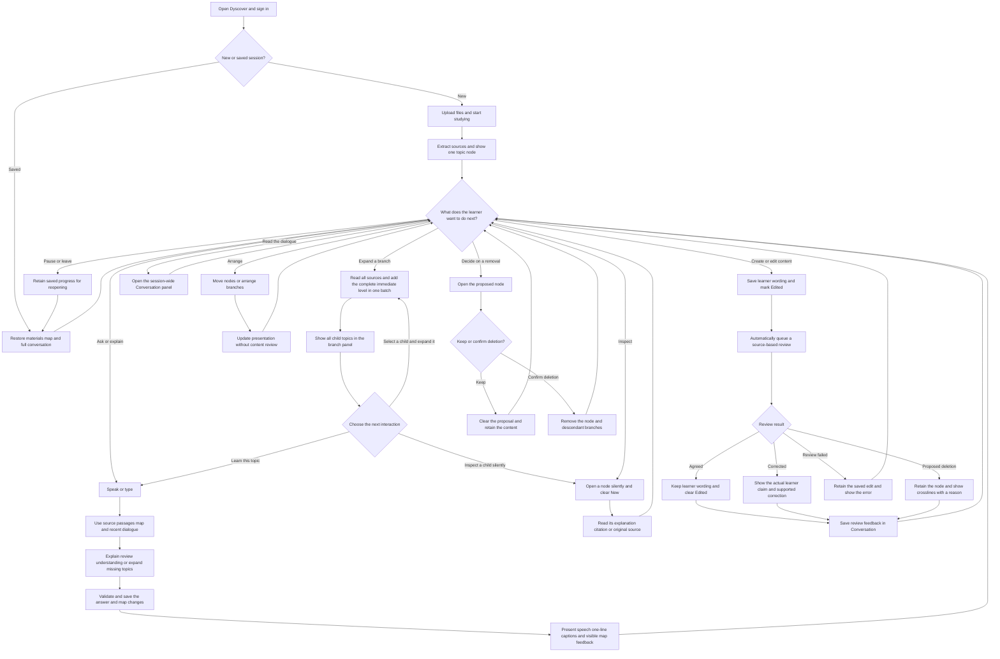

# Dyscover interactive workflow

Interaction is continuous: the learner can ask, inspect, revise, arrange, and review the conversation throughout a study thread. These branches describe available actions, not mandatory interaction-mode buttons.

The current prototype applies ordinary validated additions and corrections directly. Only deletion has a required confirmation step. Captions roll within one line, while complete messages remain in Conversation. Tutor-explained source-supported ideas are mapped immediately. Explicit expansion reveals a complete immediate branch level; the learner then chooses a child to expand or returns to learning. Moving a node and opening a node do not trigger tutor review.

See [the interactive design architecture](DESIGN_ARCHITECTURE.md) for responsibilities, review sequencing, state meanings, and current limitations.
